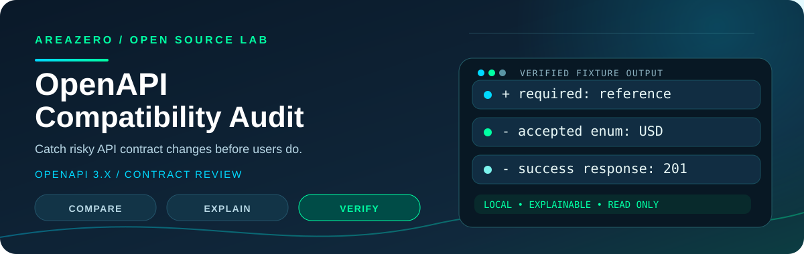
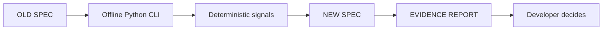

<p align="center">
  <a href="https://github.com/Kanompung1988/openapi-compat-audit"></a>
</p>

<p align="center"></p>

<h3 align="center">Catch risky API contract changes before users do.</h3>

<p align="center">An offline, evidence-first API contract diff for developer agents and release engineers.<br>Built for <b>Claude Code</b>, <b>Codex</b>, and developers who want reproducible evidence instead of guesses.</p>

<p align="center">
<a href="https://github.com/Kanompung1988/openapi-compat-audit/actions/workflows/ci.yml"></a>
<a href="https://agentskills.io/specification"></a>

<a href="LICENSE"></a>

</p>

<p align="center"><a href="#quick-start"><b>Quick start</b></a> · <a href="#see-it-work"><b>See it work</b></a> · <a href="#install-as-an-agent-skill"><b>Install in Claude / Codex</b></a> · <a href="#tests--evidence"><b>Tests</b></a> · <a href="CONTRIBUTING.md"><b>Contributing</b></a> · <a href="SECURITY.md"><b>Security</b></a></p>

> [!IMPORTANT]
> **No magical claims.** This is an explainable, offline engineering helper—not a proof of safety or a fully autonomous repair agent. Test coverage and demo numbers refer to included **synthetic fixtures**. Humans remain responsible for interpreting the evidence.

## Why this exists

API contracts change fast. A tiny schema diff can reject requests from an old SDK even when the service builds successfully. This skill compares two local OpenAPI 3.x documents and flags specific contract changes with locations, severity and follow-up checks.

## At a glance

| Dimension | This project |
|---|---|
| Primary use | Routes / request fields / response contract |
| Runtime | Python 3.10+, local files, no remote LLM calls |
| Agent interface | [Portable `SKILL.md`](SKILL.md), [Agent Skills specification](https://agentskills.io/specification) |
| Implementation | [`scripts/compare_openapi.py`](scripts/compare_openapi.py) |
| Regression suite | [`tests/`](tests/) |
| Demo inputs and reports | [`examples/`](examples/) |
| Ownership | Areazero Open Source Lab · [@Kanompung1988](https://github.com/Kanompung1988) |

## What it checks

| Signal or condition | Report behavior |
|---|---|
| Removed HTTP operations | Breaking finding |
| New required query/header/path parameters | Breaking finding |
| New required JSON body properties | Breaking finding |
| Request enum narrowed | Breaking finding |
| Removed 2xx response status/media | Breaking finding |
| Response type changes and composed schemas | Manual review warning |

## Quick start

```bash
git clone https://github.com/Kanompung1988/openapi-compat-audit.git
cd openapi-compat-audit
python3 scripts/compare_openapi.py --old examples/openapi-before.json --new examples/openapi-after.json --format json
```

The command above runs against **synthetic test fixtures stored in this repository**. JSON input requires only the Python standard library. Install PyYAML separately *only if* you need YAML input.

## See it work

### A payment API that silently broke older clients

```bash
python3 scripts/compare_openapi.py --old examples/openapi-before.json --new examples/openapi-after.json --format json
```

**Verified fixture:** The included synthetic OpenAPI fixtures produce exactly 3 breaking findings: a new required `reference` field, a narrowed `currency` enum, and a removed 201 response.

<details><summary><b>Inspect the sample evidence</b></summary>

- [Actual fixture: openapi-before.json](examples/openapi-before.json)
- [Actual fixture: openapi-after.json](examples/openapi-after.json)
- [Actual fixture: openapi-demo-report.md](examples/openapi-demo-report.md)

Expected short summary:

```json
{"summary": {"breaking": 3, "review": 0}}
```

</details>

## Install as an Agent Skill

**Claude Code**, from the root of the *project you want the skill to support*:

```bash
mkdir -p .claude/skills
git clone --depth 1 https://github.com/Kanompung1988/openapi-compat-audit.git .claude/skills/openapi-compat-audit
```

**Codex**, from your target project root:

```bash
mkdir -p .agents/skills
git clone --depth 1 https://github.com/Kanompung1988/openapi-compat-audit.git .agents/skills/openapi-compat-audit
```

Both tools discover a `SKILL.md` in the skill directory. Restart/reload the agent if a newly copied skill is not recognized. You can also install this folder in your personal skills directory rather than a project. No plugin key or cloud service is required. Reference: [open Agent Skills spec](https://agentskills.io/specification).

### Good triggers

- Review a pull request that changes an OpenAPI 3.x contract
- Run a backwards-compatibility preflight before a versioned API release
- Prepare an SDK upgrade and want specific contract findings to verify

### When not to use it

- You need live traffic compatibility, semantic polymorphism analysis, or runtime behavior guarantees
- Your specification is exclusively GraphQL, AsyncAPI, or OpenAPI 2.0
- You cannot provide two authorized local baseline/candidate specs

## Architecture



The agent's instruction contract is [SKILL.md](SKILL.md), implementation is readable Python, and the sample inputs live under [examples/](examples/). The script does not make network calls or modify the inputs.

## Project structure

```text
openapi-compat-audit/
├── SKILL.md                    # Agent triggers, workflow, limitations
├── README.md                   # This documentation
├── scripts/compare_openapi.py    # Offline CLI
├── references/                 # Coverage and signal interpretation
├── tests/                      # Unit + packaging / brand checks
├── qa/smoke.py                 # Verified synthetic CLI example
├── examples/                   # Reproducible sample inputs/reports
├── assets/hero.svg             # Original project-specific illustration
├── assets/area-zero-logo-*.svg # Original logo bytes, unmodified
├── .github/workflows/ci.yml    # Python 3.10 / 3.12 matrix
├── CONTRIBUTING.md · SECURITY.md · BRAND.md
└── LICENSE                    # MIT (code only)
```

## Tests & evidence

Run locally:

```bash
python3 -m compileall -q scripts tests qa
python3 -m unittest discover -s tests -v
python3 qa/smoke.py
```

The [live GitHub Actions workflow](.github/workflows/ci.yml) runs these checks on **Python 3.10 and 3.12** for new PRs and changes to `main`. The current status is visible in the badge above. The original implementation was validated as part of [AREAZERO Skill Lab EP.01](https://github.com/Kanompung1988/agent-skills/pull/1); new per-repository CI is the authoritative record for the standalone package.

The **internal QA totals are not adoption metrics**, an independent external review, or an official `skills-ref` result. See [Evidence and limitations](docs/QUALITY.md).

## Safety & limitations

Heuristics are not an exhaustive OpenAPI semantic solver. External `$ref`, polymorphic schema rules, auth changes and runtime behavior need manual tests. Zero findings does **not** prove client compatibility.

The default CLI reads local files and writes no output file unless you request `--out`. No credentials are required and the implementation never deploys or applies fixes. Read the full [security policy](SECURITY.md) before processing real production inputs.

## Roadmap

- Expand parameter-location and reference coverage without fetching external schemas
- Add more synthetic SDK-compatibility counterexamples
- Provide optional GitHub PR comment output only after explicit user approval

We prioritize real, reproducible developer problems over creating a large catalogue of thin wrappers. Have a failing example? [Open an issue](https://github.com/Kanompung1988/openapi-compat-audit/issues) with an anonymized fixture and a proposed test.

## Credits · license · attribution

Created and maintained by **AREAZERO Skill Lab — ทำให้ AI เก่งขึ้นทุกวัน**. Source originated in the verified [2026-10-24 EP.01](https://github.com/Kanompung1988/agent-skills/pull/1), and moved into this dedicated public repository for focused collaboration. The scripts and documentation are licensed under [MIT](LICENSE); the official Area Zero marks are **not** MIT-licensed. Details: [BRAND.md](BRAND.md).

<p align="center"><b>Useful code. Reproducible tests. Honest claims.</b><br><sub>AREAZERO SKILL LAB · GitHub @Kanompung1988</sub></p>
